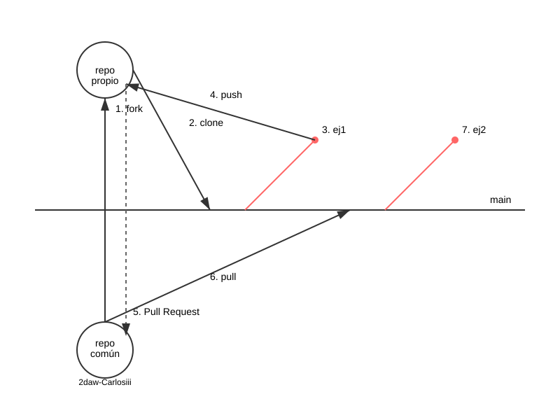
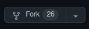
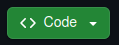

# 5.1. Instalación de _Laravel_ y desarrollo colaborativo

> **Bloque 5 · Generación dinámica de páginas web: introducción a _Laravel_ (RA5).** _marcapersonalFP v0_ funciona, pero cada página es un script que mezcla HTML, lógica y datos, y todo lo hemos programado a mano: la sesión, el _login_, la validación, el escape de la salida. En este bloque la reconstruimos con _Laravel_, un _framework_ que **separa la lógica de negocio de la presentación** y automatiza buena parte de ese trabajo. Los datos de la aplicación seguirán en arrays hasta el Bloque 6, donde llegarán _MariaDB_ y _Eloquent_. Mientras tanto, _Laravel_ guarda sus propias tablas (sesiones, caché, usuarios) en un fichero _SQLite_.

**Presentación de apoyo** (_RevealJS_): [RA5_1_instalacion_slides.html](./materiales/slides/RA5_1_instalacion_slides.html)

## ¿Qué es un _framework_?

En [§11 de la preparación del entorno](./00_instalacionEntorno.md#11-proyecto-vanilla_php-y-phpunit-bloques-2-a-4) definimos un _framework_ como una capa de librerías y convenciones que automatiza buena parte del trabajo a cambio de que sigas sus reglas. Después de construir _v0_, ya sabemos qué trabajo es ese.

Con _Laravel_:

- **Una sola puerta de entrada.** Todas las peticiones llegan a `public/index.php`, y un fichero de **rutas** decide qué código las atiende. Se acabó un script por página.
- **Cada cosa en su sitio.** La lógica va en **controladores** y clases de `app/`, y el HTML en **vistas** _Blade_. Es el patrón **MVC** (Modelo-Vista-Controlador), que estudiaremos en 5.8.
- **Lo repetitivo ya está hecho.** Sesiones, protección contra CSRF, validación, autenticación, escape de la salida.

## El plan de trabajo del bloque

Al cerrar 3.8 y 4.4 anotamos qué automatiza el framework de cada pieza de _v0_. Esas dos tablas son el plan de este bloque:

| En _v0_ (a mano) | En _Laravel_ | Apartado |
|---|---|---|
| Un script en `public/` por página | **Rutas** y **controladores** | 5.3, 5.5 |
| `require_once` de cada fichero de `src/` | **Autoload** de _Composer_ con espacios de nombres | 5.2 |
| `session_start()` con sus opciones | Lo hace el framework (`config/session.php`) | 5.2 |
| HTML con `<?php if (): ?>` y `<?= e() ?>` | Plantillas **Blade**: `@if`, `{{ }}` | 5.4 |
| `ValidadorCurriculo::validar()` | `$request->validate([...])` o un _Form Request_ | 5.6 |
| `value="<?= e($datos['alumno'] ?? '') ?>"` | `old('alumno')` | 5.6 |
| `$_SESSION['mensaje']` + `unset()` | `redirect()->with('mensaje', '…')` | 5.6 |
| `password_hash()` y `Autenticador` | `Hash::make()` y `Auth::attempt()`, con _Breeze_ | 5.7 |
| `exigirLogin()` | _Middleware_ `auth` | 5.7 |
| Las clases de `src/` | Clases en `app/` y un **repositorio** | 5.8 |

El resto de filas (los modelos _Eloquent_, `Ciclo::all()`, la tabla `curriculos` y `exigirRol()`) corresponden a los Bloques 6 y 7.

Usamos **_Laravel_ 13**, publicado en marzo de 2026, que requiere PHP 8.3 o superior. Nuestro entorno tiene PHP 8.4 ([§5 de la preparación del entorno](./00_instalacionEntorno.md#5-seleccionar-la-versión-de-php-y-el-motor-de-base-de-datos)).

## Un repositorio por curso

El proyecto _Laravel_ de _marcapersonalFP_ se desarrolla en grupo, sobre un repositorio de _GitHub_ por curso. Intervienen tres copias del código:

| Copia | Dónde | Remoto en tu clon |
|---|---|---|
| **Repositorio base** | `github.com/2DAW-CarlosIII/marcapersonalfp2627` | `upstream` |
| **Tu _fork_** | `github.com/<tu-usuario>/marcapersonalfp2627` | `origin` |
| **Tu clon local** | `~/Documentos/laravel/marcapersonalfp` | — |

Tú trabajas en el clon local, subes tus ramas a tu _fork_ y, desde allí, propones los cambios al repositorio base con un _pull request_.



> **Cómo se creó el repositorio base (profesorado).** Una vez por curso, el profesorado genera el esqueleto con _Composer_ y lo sube a la organización. En la máquina virtual no hay PHP instalado, así que _Composer_ se ejecuta en un contenedor de usar y tirar de la imagen `thecodingmachine/php`, que crea los ficheros a nombre del dueño de la carpeta (no de _root_):
>
> ```bash
> cd ~/Documentos/laravel
> docker run -it --rm -v "$PWD:/usr/src/app" thecodingmachine/php:8.4-v4-slim-cli \
>     composer create-project laravel/laravel:^13.0 marcapersonalfp
> ```
>
> `create-project` descarga el esqueleto, instala sus dependencias y ejecuta los _scripts_ de `post-create-project-cmd` de `composer.json`: entre ellos, crear el fichero `database/database.sqlite` y ejecutar las migraciones. Con esta imagen, las migraciones fallan con `could not find driver`, porque la variante `slim` no trae el controlador de _SQLite_ de PHP, y el fichero se queda vacío. No importa: la base no se sube al repositorio.
>
> La carpeta local se llama `marcapersonalfp`, aunque el repositorio de _GitHub_ lleve el curso en el nombre. Después, con un repositorio vacío ya creado en la organización (público, sin `README` ni licencia):
>
> ```bash
> cd marcapersonalfp
> git init -b main
> git add .
> git commit -m "Esqueleto de Laravel 13"
> git remote add origin git@github.com:2DAW-CarlosIII/marcapersonalfp2627.git
> git push -u origin main
> ```
>
> El `.gitignore` del esqueleto deja fuera `vendor/`, `.env` y el fichero de la base _SQLite_. Por eso el alumnado tiene que regenerarlos en el paso 4.

## Paso 1: el _fork_

Entra en el repositorio base y pulsa el botón , arriba a la derecha. _GitHub_ crea una copia en tu cuenta: tu _fork_.

## Paso 2: el clon local

Los comandos `git` se ejecutan **en la máquina virtual**, donde están tus claves SSH. Copia la dirección SSH de tu _fork_ con el botón  y clónalo en `~/Documentos/laravel` con el nombre `marcapersonalfp`, el mismo todos los cursos:

```bash
cd ~/Documentos/laravel
git clone git@github.com:<tu-usuario>/marcapersonalfp2627.git marcapersonalfp
cd marcapersonalfp
git remote add upstream git@github.com:2DAW-CarlosIII/marcapersonalfp2627.git
git remote -v
```

`git remote -v` debe mostrar `origin` (tu _fork_) y `upstream` (el repositorio base). Si aún no tienes una clave SSH en _GitHub_, sigue [su guía](https://docs.github.com/es/authentication/connecting-to-github-with-ssh/adding-a-new-ssh-key-to-your-github-account).

## Paso 3: un terminal dentro de `workspace`

_Composer_ y _Artisan_, la herramienta de línea de comandos de _Laravel_, necesitan PHP, que está en el contenedor `workspace`. En este bloque vas a lanzar muchos comandos seguidos, así que en lugar de anteponer `docker compose exec` a cada uno, **abre un terminal dentro del contenedor**. Desde la carpeta `laradock`:

```bash
cd ~/Documentos/laravel/laradock
docker compose up -d nginx php-fpm workspace
docker compose exec --user=laradock --workdir /var/www/marcapersonalfp workspace bash
```

El indicador del terminal cambia a `laradock@…:/var/www/marcapersonalfp$`: ya estás dentro, en la carpeta del proyecto. Para salir, `exit`.

**¿Por qué `--user=laradock`?** Por defecto, `docker compose exec` entra como _root_, y los ficheros que crea pertenecen a _root_.

- En `vanilla_php` no importaba: `php-fpm` solo **leía** los ficheros.
- En _Laravel_, `php-fpm`, que atiende las peticiones como el usuario `www-data`, también **escribe**: en el fichero de la base _SQLite_, en los registros de `storage/logs/` y en las vistas compiladas de `storage/framework/`. Si los ha creado _root_, no puede modificarlos y la web responde con un error 500.
- `laradock` es tu usuario de la máquina virtual (el mismo número de usuario), y dentro de `php-fpm` ese usuario es `www-data`. Con `--user=laradock`, todo lo que crees será tuyo y `php-fpm` podrá escribirlo.

A partir de aquí, y en todo el bloque, los comandos `composer` y `php artisan` se escriben en este terminal. Los de `git` y `docker compose`, en otro terminal de la máquina virtual.

## Paso 4: dependencias y configuración

En el terminal de `workspace`:

```bash
composer install
cp .env.example .env
php artisan key:generate
php artisan migrate
```

1. **`composer install`** descarga en `vendor/` las librerías que fija `composer.lock`, las mismas versiones exactas para todo el grupo.
2. **`.env`** guarda la configuración propia de cada instalación: nombre de la aplicación, modo de depuración, base de datos… Contiene secretos, así que nunca se sube al repositorio. Se sube su plantilla, `.env.example`.
3. **`key:generate`** escribe en `.env` una clave aleatoria, `APP_KEY`, con la que _Laravel_ cifra las _cookies_ y la sesión.
4. **`migrate`** crea las tablas que el framework necesita. El `.env` indica `DB_CONNECTION=sqlite` y el fichero `database/database.sqlite` aún no existe, así que _Artisan_ pregunta si quieres crearlo: responde que sí.

Comprueba versiones y configuración con:

```bash
php artisan about
```

Debe mostrar _Laravel_ 13 y PHP 8.4.

## Paso 5: el sitio de _nginx_

El sitio por defecto de _nginx_ (`http://localhost`) sigue sirviendo `vanilla_php`: los tests de los Bloques 2 a 4 lo necesitan ([§11 de la preparación del entorno](./00_instalacionEntorno.md#11-proyecto-vanilla_php-y-phpunit-bloques-2-a-4)). _Laravel_ tendrá **su propio sitio**, `http://marcapersonalfp.test`. En un terminal de la máquina virtual:

1. Copia la plantilla de sitio _Laravel_ que trae _Laradock_:

    ```bash
    cd ~/Documentos/laravel/laradock/nginx/sites
    cp laravel.conf.example marcapersonalfp.conf
    ```

2. En `marcapersonalfp.conf`, cambia estas dos líneas:

    ```nginx
    server_name marcapersonalfp.test;
    root /var/www/marcapersonalfp/public;
    ```

    `root` apunta a `public/`, la única carpeta que _nginx_ debe servir. El resto del proyecto (`.env`, `vendor/`, `app/`…) queda fuera de su alcance.

3. Haz que el nombre `marcapersonalfp.test` apunte a tu propia máquina:

    ```bash
    echo "127.0.0.1  marcapersonalfp.test" | sudo tee -a /etc/hosts
    ```

4. Reinicia _nginx_ desde la carpeta `laradock`:

    ```bash
    cd ~/Documentos/laravel/laradock
    docker compose restart nginx
    ```

Abre [http://marcapersonalfp.test](http://marcapersonalfp.test): debe aparecer la página de bienvenida de _Laravel_. Y [http://localhost](http://localhost) sigue mostrando `vanilla_php`.

## Paso 6: trabajar en ramas

En `main` solo entra lo que ya se ha revisado en el repositorio base. Cada apartado se resuelve en su propia rama:

1. Crea la rama antes de empezar, en el terminal de la máquina virtual:

    ```bash
    git switch -c RA5_1
    ```

2. Al terminar, guarda los cambios en un _commit_ y sube la rama a **tu _fork_**:

    ```bash
    git add .
    git commit -m "Soluciona los ejercicios de 5.1"
    git push -u origin RA5_1
    ```

3. En _GitHub_, abre un **_pull request_** de tu rama hacia el `main` del repositorio base. Al principio los revisa y acepta el profesorado. Más adelante, también podrán hacerlo compañeros con permisos en el repositorio base.
4. Cuando se acepte (_merge_), actualiza tu `main` local y el de tu _fork_:

    ```bash
    git switch main
    git pull upstream main
    git push origin main
    ```

## Preparación del entorno de trabajo

Necesitas el entorno de [0. Instalación y preparación del entorno](./00_instalacionEntorno.md), con los contenedores `nginx`, `php-fpm` y `workspace` levantados. _MariaDB_ no hace falta hasta el Bloque 6.

## Ejercicios

1. **Fork y clon.** Haz el _fork_ del repositorio base y clónalo en `~/Documentos/laravel/marcapersonalfp`, con el remoto `upstream` (pasos 1 y 2). Crea la rama `RA5_1`.
2. **Instalación.** Abre el terminal de `workspace` como `laradock`, instala las dependencias, crea el `.env`, genera la clave y ejecuta las migraciones (pasos 3 y 4). Anota en un comentario de tu _pull request_ qué versiones muestra `php artisan about`.
3. **Sitio de _nginx_.** Configura `http://marcapersonalfp.test` (paso 5) y comprueba en el navegador que `http://localhost` sigue sirviendo `vanilla_php`.
4. **Configuración.** En el `.env`, cambia estas dos variables:

    ```ini
    APP_NAME=marcapersonalFP
    APP_URL=http://marcapersonalfp.test
    ```

    _Laravel_ lee el `.env` en cada petición, así que el cambio se aplica sin reiniciar nada. Las veremos de nuevo en 5.2, al estudiar la carpeta `config/`.

5. **Tu primer _pull request_.** Copia el test de este apartado (ver más abajo) a `tests/Feature/`, comprueba que pasa y súbelo en un _commit_ a tu rama. Abre el _pull request_ hacia el repositorio base (paso 6).
6. **Investiga.** Abre `composer.json` y busca la sección `scripts` → `post-create-project-cmd`. ¿Qué comandos contiene? ¿Cuáles del paso 4 se ahorró el profesorado al crear el repositorio base? ¿Por qué tú sí tuviste que ejecutarlos? Responde en el _pull request_.

> **Puente.** Para `vanilla_php` lo hicimos todo a mano: la carpeta `public/`, un `composer.json` con PHPUnit, el `phpunit.xml` y el sitio de _nginx_. _Laravel_ trae de serie su `public/index.php`, su `composer.json`, su `phpunit.xml` y una carpeta `tests/`. Solo el sitio de _nginx_ sigue siendo cosa nuestra.

## Comprueba tu solución automáticamente (opcional)

Para los ejercicios 1 a 4, copia el archivo [RA5_1_InstalacionTest.php](./materiales/ejercicios-laravel/tests/Feature/RA5_1_InstalacionTest.php) a la carpeta `tests/Feature/` de tu proyecto y ejecuta, en el terminal de `workspace`, ese test en concreto:

```bash
php artisan test --filter=RA5_1_InstalacionTest
```

El test comprueba:
- los remotos `origin` y `upstream` de tu clon;
- la clave de la aplicación y la base _SQLite_ con sus tablas;
- las dos variables del ejercicio 4;
- que `http://marcapersonalfp.test` sirve _Laravel_: hace una petición real a `nginx`, como el navegador.

Necesita `nginx` y `php-fpm` levantados.

Si todo está bien: `Tests: 6 passed (13 assertions)`.

---

**Siguiente:** [5.2. Estructura de un proyecto, configuración y _Artisan_](./RA5_2_estructura.md)
