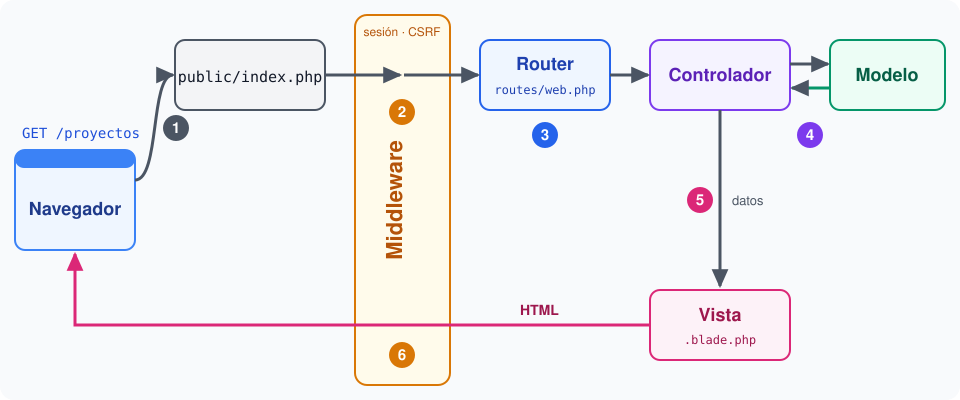
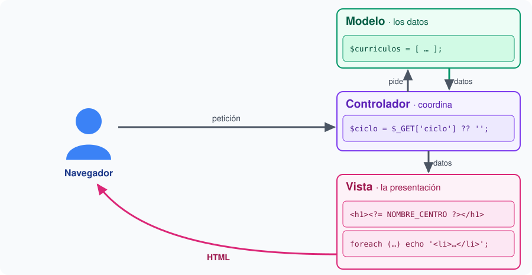

# 5.2. Estructura de un proyecto, configuración y _Artisan_

**Presentación de apoyo** (_RevealJS_): [RA5_2_estructura_slides.html](./materiales/slides/RA5_2_estructura_slides.html)

## De `vanilla_php` a un proyecto _Laravel_

En 5.1 instalamos el proyecto sin mirar dentro. Antes de escribir código conviene saber **dónde va cada cosa**, porque _Laravel_ funciona por convenciones: si un fichero está en su sitio y se llama como debe, el framework lo encuentra solo.

La idea ya la conocemos de `vanilla_php`. Allí separamos lo público (`public/`) del resto (`src/`, `tests/`, `vendor/`). _Laravel_ lleva esa separación mucho más lejos:

| En `vanilla_php` | En _Laravel_ |
|---|---|
| Un script por página en `public/` | Un único `public/index.php` |
| Funciones y clases en `src/` | Clases en `app/`, con espacio de nombres |
| HTML mezclado con PHP en cada script | Vistas en `resources/views/` |
| Constantes y opciones en el código | `.env` y la carpeta `config/` |
| `tests/` y `phpunit.xml` | `tests/` y `phpunit.xml`, ya preparados |

## La estructura de carpetas

Abre la carpeta `marcapersonalfp` en VS Code. En la raíz encontrarás estas carpetas:

| Carpeta | Qué contiene | ¿La tocamos? |
|---|---|---|
| `app/` | El código de la aplicación: controladores, modelos, clases propias | Constantemente |
| `bootstrap/` | El arranque del framework (`app.php`) | Muy poco |
| `config/` | Un fichero de configuración por tema: `app.php`, `session.php`, `database.php`… | A veces |
| `database/` | Migraciones, _seeders_ y el fichero _SQLite_ | En el Bloque 6 |
| `public/` | `index.php`, la puerta de entrada, y los ficheros públicos (imágenes, CSS compilado) | Poco |
| `resources/` | Las vistas (`views/`) y los fuentes de CSS y JavaScript | Constantemente |
| `routes/` | Las rutas: `web.php` para las páginas, `console.php` para los comandos | Constantemente |
| `storage/` | Lo que el framework genera al funcionar: registros, sesiones, vistas compiladas | Solo para leer los registros |
| `tests/` | Los tests, en `Feature/` y `Unit/` | Al copiar los de cada apartado |
| `vendor/` | Las librerías que instala _Composer_ | Nunca |

Y en la raíz, estos ficheros:

- **`artisan`**: la herramienta de línea de comandos (ver [Artisan](#artisan)).
- **`composer.json`** y **`composer.lock`**: las dependencias de PHP y sus versiones exactas.
- **`.env`** y **`.env.example`**: la configuración de esta instalación y su plantilla (ver [Configuración](#configuración-env-y-config)).
- **`package.json`** y **`vite.config.js`**: las dependencias de JavaScript y la compilación del CSS. Las usaremos con _Breeze_ (5.7).
- **`phpunit.xml`**: la configuración de los tests.

Dentro de `app/`, un proyecto recién creado solo trae tres piezas:

- `app/Http/Controllers/Controller.php`: la clase base de los controladores (5.5).
- `app/Models/User.php`: el modelo de usuario, que usará _Breeze_ (5.7).
- `app/Providers/AppServiceProvider.php`: el lugar donde se registran servicios al arrancar (5.8).

Cuando generes otras piezas con _Artisan_ (controladores, _middleware_, _Form Requests_…), _Laravel_ creará la subcarpeta que corresponda.

## El ciclo de vida de una petición

En `vanilla_php`, cada página era un script distinto. En _Laravel_, **todas** las peticiones entran por `public/index.php`. Por eso, en 5.1, el `root` del sitio de _nginx_ apuntaba a `public/`.

Lo esencial de `public/index.php` son tres líneas:

```php
require __DIR__.'/../vendor/autoload.php';                  // 1. el autoload de Composer

$app = require_once __DIR__.'/../bootstrap/app.php';         // 2. crea la aplicación

$app->handleRequest(Request::capture());                     // 3. atiende la petición
```

A partir de ahí, la petición recorre estos pasos:

1. **`Request::capture()`** reúne en un objeto todo lo que en _v0_ leíamos de `$_GET`, `$_POST`, `$_COOKIE` y `$_SERVER`.
2. La petición atraviesa el **_middleware_** (5.7): capas que la examinan antes de llegar a nuestro código. Una de ellas abre la sesión; otra comprueba el _token_ CSRF.
3. El **enrutador** busca en `routes/web.php` la ruta que coincide con el método y la dirección (5.3).
4. La ruta llama a su **acción**: una función o un método de un **controlador** (5.5), que obtiene los datos de los **modelos**.
5. El controlador devuelve una **vista** (5.4) con esos datos.
6. La respuesta vuelve a atravesar el _middleware_, que, por ejemplo, guarda la sesión, y llega al navegador.



Los números del esquema son los pasos de la lista. Fíjate en el _middleware_: la petición lo atraviesa a la ida y la respuesta, a la vuelta.

Esta división es el patrón **MVC** (Modelo-Vista-Controlador), que formalizaremos en 5.8. Cada pieza tiene una sola responsabilidad: los datos, en el modelo; la presentación, en la vista; y el controlador las coordina. En _v0_, un mismo script hacía las tres cosas; con MVC, cada línea pasa a la pieza que le corresponde:



## Adiós a `require_once`: el _autoload_ de _Composer_

En _v0_, cada página cargaba a mano lo que necesitaba, y cada fichero de `src/` cargaba a su vez sus dependencias:

```php
require_once __DIR__ . '/../src/RA3_formularios.php';
require_once __DIR__ . '/../src/ValidadorCurriculo.php';   // que hace require_once de Curriculo.php
```

Con unas pocas clases es manejable. Con cientos, como en _Laravel_, sería imposible. La solución tiene dos partes.

**1. Espacios de nombres.** Cada clase declara a qué **espacio de nombres** (_namespace_) pertenece, como una carpeta para nombres de clases. Así pueden convivir dos clases `Curriculo` en espacios distintos. Para usar una clase de otro espacio se importa con `use`:

```php
<?php

namespace App\Http\Controllers;     // esta clase es App\Http\Controllers\ProyectosController

use App\Models\User;                // a partir de aquí, "User" significa App\Models\User

class ProyectosController extends Controller
{
    // ...
}
```

**2. La correspondencia entre nombres y carpetas (PSR-4).** En `composer.json`, la sección `autoload` dice dónde buscar cada espacio de nombres:

```json
"autoload": {
    "psr-4": {
        "App\\": "app/",
        "Database\\Factories\\": "database/factories/",
        "Database\\Seeders\\": "database/seeders/"
    }
}
```

Cuando el código usa `App\Models\User` por primera vez, el _autoload_ cambia `App\` por `app/`, las barras invertidas por barras normales y añade `.php`: carga `app/Models/User.php`. Ningún `require_once`: basta con que **la ruta del fichero coincida con su espacio de nombres**. Es la convención "una clase por fichero, con su nombre" que empezamos en [3.5](./RA3_5_poo.md).

Si alguna vez cambias la sección `autoload` de `composer.json`, regenera el mapa con `composer dump-autoload`. Para crear clases nuevas dentro de `app/` no hace falta.

## Configuración: `.env` y `config/`

En _v0_, los datos de configuración estaban escritos en el código: `define('NOMBRE_CENTRO', 'CIFP Carlos III')` en 2.3, o las opciones de `session_start()` en 4.1. Para cambiarlos había que editar el programa. _Laravel_ separa la configuración en tres niveles:

1. **`.env`**: los valores de **esta instalación**. Cambian de una máquina a otra y pueden ser secretos (la clave, las contraseñas de la base de datos). No se sube al repositorio.
2. **`config/*.php`**: un fichero por tema, que devuelve un array. Cada opción lee su valor del `.env` con `env()`, y lleva un valor por defecto por si no está definido. Estos ficheros **sí** se suben.
3. **`config()`**: la forma de leer cualquier opción desde el código, con la notación `fichero.clave`.

Por ejemplo, en `config/app.php`:

```php
'name' => env('APP_NAME', 'Laravel'),

'debug' => (bool) env('APP_DEBUG', false),

'locale' => env('APP_LOCALE', 'en'),
```

Y en cualquier parte de la aplicación:

```php
config('app.name')      // 'marcapersonalFP', el APP_NAME de tu .env (5.1)
```

> **`env()`, solo dentro de `config/`.** En producción se ejecuta `php artisan config:cache`, que junta toda la configuración en un único fichero para no leer el `.env` en cada petición. A partir de ese momento, `env()` devuelve `null` fuera de `config/`. En el resto del código, usa siempre `config()`. Si alguna vez ejecutas `config:cache` en tu máquina, los cambios del `.env` dejarán de notarse hasta que ejecutes `php artisan config:clear`.

Dos variables merecen especial atención:

- **`APP_ENV`** indica el entorno: `local` en tu máquina, `production` en el servidor, `testing` durante los tests (lo fija `phpunit.xml`).
- **`APP_DEBUG`** decide qué ve el navegador cuando algo falla. Con `true`, una página con el error, el fichero, la línea y la pila de llamadas: es lo que en `vanilla_php` conseguimos con `display_errors` ([§7 de la preparación del entorno](./00_instalacionEntorno.md#7-depuración-errores-en-pantalla-y-xdebug)). Con `false`, una página genérica de "500 Server Error", y el detalle queda en `storage/logs/laravel.log`. En producción, siempre `false`: el detalle de un error enseña a un atacante cómo es la aplicación por dentro.

### Un fichero de configuración propio

Cualquier fichero que añadas a `config/` pasa a formar parte de la configuración. Así, la constante `NOMBRE_CENTRO` de _v0_ se convierte en una opción de `config/marcapersonalfp.php`:

```php
<?php

return [

    // Nombre del centro que se muestra en la aplicación.
    'centro' => env('NOMBRE_CENTRO', 'CIFP Carlos III'),

];
```

Desde el código, `config('marcapersonalfp.centro')`. Y como el valor sale del `.env`, otro centro que use la aplicación solo tendría que cambiar una línea de su `.env`, sin tocar el código.

Cuando añadas una variable al `.env`, añádela también a **`.env.example`**: es la única forma de que tus compañeros sepan que existe, porque el `.env` no se sube.

## La sesión, ya configurada

En 4.1 abríamos la sesión con `session_start()` y le añadíamos a mano `HttpOnly` y `SameSite`, y en 4.2 lo llevamos a la función `iniciarSesion()`. En _Laravel_, un _middleware_ abre la sesión en cada petición, y sus opciones están en `config/session.php`:

```php
'driver' => env('SESSION_DRIVER', 'database'),        // dónde se guarda: la tabla sessions (5.1)

'lifetime' => (int) env('SESSION_LIFETIME', 120),    // minutos de inactividad

'http_only' => env('SESSION_HTTP_ONLY', true),       // como en 4.1

'same_site' => env('SESSION_SAME_SITE', 'lax'),      // como en 4.1
```

Lo que en _v0_ tuvimos que recordar en cada página viene así de serie. En 5.6 usaremos la sesión para los mensajes _flash_ y, en 5.7, para el _login_.

## _Artisan_

**_Artisan_** es la interfaz de línea de comandos de _Laravel_: el fichero `artisan` de la raíz, que se ejecuta con `php artisan`. Ya usamos tres de sus comandos en 5.1 (`key:generate`, `migrate` y `about`).

Para ver todos los comandos, o la ayuda de uno concreto:

```bash
php artisan list
php artisan help make:controller
```

Estos son los que usaremos en el bloque:

| Comando | Para qué | Apartado |
|---|---|---|
| `about` | Versiones y configuración principal | 5.1 |
| `config:show app` | Todas las opciones de un fichero de `config/` | 5.2 |
| `tinker` | Una consola para probar código PHP dentro de la aplicación | 5.2 |
| `route:list` | Todas las rutas de la aplicación | 5.3 |
| `make:controller` | Genera un controlador | 5.5 |
| `make:request` | Genera un _Form Request_ | 5.6 |
| `test` | Ejecuta los tests | todo el bloque |

Los comandos `make:` son **generadores**: crean el fichero en la carpeta correcta, con el espacio de nombres correcto y el esqueleto de la clase. Así no hay que memorizar las convenciones.

**Tinker** es especialmente útil para explorar. Dentro de él, cada línea se ejecuta con toda la aplicación cargada:

```text
> config('app.name')
= "marcapersonalFP"

> app()->environment()
= "local"
```

Para salir, `exit`.

### Comandos propios

En `routes/console.php` se definen comandos con una función. El proyecto ya trae uno, `inspire`, que muestra una cita:

```php
Artisan::command('inspire', function () {
    $this->comment(Inspiring::quote());
})->purpose('Display an inspiring quote');
```

- El primer argumento es el **nombre** del comando: `php artisan inspire`.
- Dentro de la función, `$this` es el comando, con métodos para escribir en el terminal: `info()` (en verde), `comment()` (en amarillo), `error()` (en rojo).
- **`purpose()`** es la descripción que aparece en `php artisan list`.

## Preparación del entorno de trabajo

Seguimos en el proyecto `marcapersonalfp` de [5.1](./RA5_1_instalacion.md), con el terminal de `workspace` abierto como `laradock`. Antes de empezar, crea la rama del apartado en el terminal de la máquina virtual:

```bash
git switch main
git pull upstream main
git switch -c RA5_2
```

## Ejercicios

1. **Recorre la estructura.** Localiza en VS Code cada carpeta de la tabla de este apartado. Responde en tu _pull request_:
    - ¿En qué fichero está la vista de la página de bienvenida?
    - ¿En qué fichero se define la ruta que la muestra? Copia sus líneas.
    - ¿Qué hay en `storage/logs/`? ¿Y en `storage/framework/sessions/`? ¿Por qué esta última está vacía? (Pista: el `SESSION_DRIVER` de tu `.env`.)
2. **Sigue una petición con Xdebug.** Abre la carpeta `marcapersonalfp` en VS Code y crea `.vscode/launch.json` como en [4.3](./RA4_3_xdebug.md), con este `pathMappings`:

    ```json
    "pathMappings": {
        "/var/www/marcapersonalfp": "${workspaceFolder}"
    }
    ```

    Pon un punto de ruptura en la última línea de `public/index.php`, empieza a escuchar (<kbd>F5</kbd>) y pide `http://marcapersonalfp.test` con el disparador (con _Xdebug Helper_ o con `?XDEBUG_TRIGGER=1`). Entra con <kbd>F11</kbd> en `handleRequest()` y avanza unos pasos. Anota en tu _pull request_ el nombre de tres clases de _Laravel_ por las que pasa la petición (las verás en la **Pila de llamadas**).

    Comprueba que el `.gitignore` del proyecto excluye `/.vscode` (si no, añádelo): es configuración de tu editor, no de la aplicación.
3. **Configuración regional.** En el `.env`, cambia estas dos variables:

    ```ini
    APP_LOCALE=es
    APP_FAKER_LOCALE=es_ES
    ```

    `APP_LOCALE` es el idioma de la aplicación; `APP_FAKER_LOCALE`, el de los datos de prueba que generaremos en el Bloque 6. Compruébalo con `php artisan config:show app`.

4. **Un fichero de configuración propio.** Crea `config/marcapersonalfp.php` como en este apartado. Añade la variable a tu `.env` **y** a `.env.example`:

    ```ini
    NOMBRE_CENTRO="CIFP Carlos III"
    ```

    Las comillas son necesarias porque el valor tiene espacios. Compruébalo en `php artisan tinker` con `config('marcapersonalfp.centro')`.

5. **Un comando propio.** En `routes/console.php`, debajo de `inspire`, crea el comando `marcapersonalfp:centro`. Debe escribir en verde el nombre del centro, leído de la configuración del ejercicio 4, y tener una descripción:

    ```php
    Artisan::command('marcapersonalfp:centro', function () {
        $this->info(config('marcapersonalfp.centro'));
    })->purpose('Muestra el nombre del centro');
    ```

    Ejecútalo con `php artisan marcapersonalfp:centro` y búscalo en `php artisan list`.

6. **Investiga.** Responde en tu _pull request_:
    - Abre `vendor/composer/autoload_psr4.php`. ¿Qué línea corresponde al espacio de nombres `App\`? ¿Quién ha generado ese fichero?
    - Provoca un error: cambia temporalmente en el `.env` `SESSION_DRIVER=database` por `SESSION_DRIVER=inexistente` y pide `http://marcapersonalfp.test`. Después cambia `APP_DEBUG` a `false` y vuelve a pedirla. ¿Qué muestra el navegador en cada caso? ¿Dónde queda el detalle del error en el segundo? ¿Por qué una página de error detallada sería peligrosa en producción? Al terminar, deja las dos variables como estaban.

> **Puente.** En _v0_, `NOMBRE_CENTRO` era una constante escrita en cada página que la necesitaba, y las opciones de la sesión se repetían hasta que las llevamos a `iniciarSesion()`. En _Laravel_, la configuración vive fuera del código: en el `.env` lo que cambia de una instalación a otra, y en `config/` el resto, con un valor por defecto. Esto que hicimos a mano, el framework lo automatiza así.

## Comprueba tu solución automáticamente (opcional)

Para los ejercicios 3 a 5, copia el archivo [RA5_2_EstructuraTest.php](./materiales/ejercicios-laravel/tests/Feature/RA5_2_EstructuraTest.php) a la carpeta `tests/Feature/` de tu proyecto y ejecuta, en el terminal de `workspace`, ese test en concreto:

```bash
php artisan test --filter=RA5_2_EstructuraTest
```

El test comprueba:
- el idioma de la aplicación y el de los datos de prueba;
- tu fichero `config/marcapersonalfp.php`, que lea `NOMBRE_CENTRO` del `.env` y que la variable esté en `.env.example`;
- que el comando `marcapersonalfp:centro` existe, tiene descripción y escribe el nombre del centro.

Si todo está bien: `Tests: 4 passed (10 assertions)`.

---

**Siguiente:** [5.3. Rutas](./RA5_3_rutas.md)
