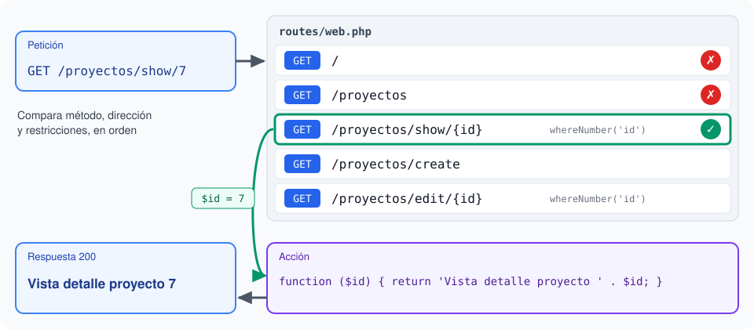

# 5.3. Rutas

**Presentación de apoyo** (_RevealJS_): [RA5_3_rutas_slides.html](./materiales/slides/RA5_3_rutas_slides.html)

## De un script por página a una ruta

En _v0_, la dirección de cada página era la de su fichero: `http://localhost/RA2_proyectoListado.php` ejecutaba `public/RA2_proyectoListado.php`. _nginx_ buscaba el fichero y se lo pasaba a PHP. Y si la página necesitaba un dato, como el identificador de un currículo, llegaba en `$_GET` y había que comprobarlo a mano.

En _Laravel_, todas las peticiones llegan a `public/index.php` (5.2). Quien decide qué código atiende cada una es el fichero **`routes/web.php`**, que asocia un **método HTTP** y una **dirección** (_URI_) con una **acción**. Un proyecto recién creado trae una sola ruta:

```php
<?php

use Illuminate\Support\Facades\Route;

Route::get('/', function () {
    return view('welcome');
});
```

Se lee así: "cuando llegue una petición **GET** a **`/`**, ejecuta esta función". La función devuelve la vista de bienvenida (las vistas, en 5.4).

Separar las direcciones de los ficheros tiene varias ventajas:

- **Direcciones limpias**: `/proyectos/show/7` en lugar de `/RA3_detalle.php?id=7`.
- **Un solo lugar** donde ver todas las páginas de la aplicación.
- **Los datos, dentro de la dirección**, y comprobados por el propio _framework_.
- **Libertad para reorganizar el código** sin cambiar las direcciones que ya conocen los usuarios.

## Métodos HTTP y rutas básicas

Cada petición HTTP lleva un **método** que indica qué se quiere hacer con el recurso:

| Método | Para qué | Ruta en _Laravel_ |
|---|---|---|
| `GET` | Consultar, sin cambiar nada | `Route::get()` |
| `POST` | Crear algo nuevo | `Route::post()` |
| `PUT` / `PATCH` | Modificar algo que existe | `Route::put()` / `Route::patch()` |
| `DELETE` | Borrar | `Route::delete()` |

Una ruta solo responde a su método. Si llega una petición a una dirección que existe, pero con otro método, _Laravel_ responde **405** (_Method Not Allowed_). Para aceptar varios métodos están `Route::match(['get', 'post'], …)` y `Route::any(…)`, aunque es raro necesitarlos.

Los formularios HTML solo saben enviar `GET` y `POST`. En 5.6 veremos cómo simular `PUT` y `DELETE`, y por qué un `POST` necesita un _token_ CSRF.

La **acción** de una ruta puede devolver distintas cosas:

- **Un texto**, que llega al navegador como HTML. Es lo que haremos en este apartado.
- **Un array**, que _Laravel_ convierte en **JSON**. Así responderá la API del Bloque 7.
- **Una vista** (5.4) o **una redirección** (5.6).

## Parámetros

Un fragmento de la dirección entre llaves es un **parámetro**. Su valor llega a la función como argumento:

```php
Route::get('proyectos/show/{id}', function ($id) {
    return 'Vista detalle proyecto ' . $id;
});
```

`/proyectos/show/7` muestra "Vista detalle proyecto 7". Y `/proyectos/show` da **404**: el parámetro es obligatorio.

Para que un parámetro sea **opcional**, se le añade `?` y la función le da un valor por defecto:

```php
Route::get('perfil/{id?}', function ($id = null) {
    // ...
});
```

### Restricciones

Tal como está, `/proyectos/show/abc` también llega a la función, con `$id = 'abc'`. Para aceptar solo números se añade una **restricción**:

```php
Route::get('proyectos/show/{id}', function ($id) {
    return 'Vista detalle proyecto ' . $id;
})->whereNumber('id');
```

Ahora `/proyectos/show/abc` no coincide con la ruta y _Laravel_ responde **404** sin ejecutar nuestro código. En _v0_ esa comprobación era cosa nuestra.

| Restricción | Acepta | Equivale a |
|---|---|---|
| `whereNumber('id')` | Solo dígitos | `where('id', '[0-9]+')` |
| `whereAlpha('nombre')` | Solo letras | `where('nombre', '[a-zA-Z]+')` |
| `where('ciclo', 'DAW\|DAM\|ASIR')` | Lo que indique la expresión regular | — |

> **Lo que devuelves, escápalo.** Si una ruta devuelve un texto que incluye un parámetro, ese parámetro lo ha escrito el usuario en la dirección. Como en 3.6, hay que escaparlo con **`e()`**, que en _Laravel_ también existe: `return '¡Hola, ' . e($nombre) . '!';`. En 5.4, las vistas _Blade_ lo harán solas.

## Rutas con nombre

A una ruta se le puede dar un **nombre**. Después, la función **`route()`** genera su dirección a partir del nombre y de sus parámetros:

```php
Route::get('proyectos/show/{id}', function ($id) {
    return 'Vista detalle proyecto ' . $id;
})->whereNumber('id')->name('proyectos.show');

route('proyectos.show', 7);    // http://marcapersonalfp.test/proyectos/show/7
```

Si mañana la dirección cambia a `/proyectos/{id}`, basta con cambiar la ruta: los enlaces generados con `route()` se actualizan solos. En cambio, una dirección escrita a mano en cada enlace habría que buscarla y cambiarla en todos. Por convenio, los nombres siguen el patrón **`recurso.acción`**: `proyectos.index`, `proyectos.show`, `proyectos.create`, `proyectos.edit`.

## Grupos de rutas

Cuando varias rutas comparten parte de su dirección y de su nombre, se agrupan. Estas dos versiones definen exactamente las mismas rutas:

```php
Route::get('proyectos', function () { /* ... */ })->name('proyectos.index');
Route::get('proyectos/create', function () { /* ... */ })->name('proyectos.create');
```

```php
Route::prefix('proyectos')->name('proyectos.')->group(function () {
    Route::get('/', function () { /* ... */ })->name('index');
    Route::get('create', function () { /* ... */ })->name('create');
});
```

- **`prefix('proyectos')`** antepone `proyectos/` a la dirección de cada ruta del grupo.
- **`name('proyectos.')`** antepone `proyectos.` a su nombre.

Un grupo también puede compartir un _middleware_: por ejemplo, que todas sus rutas exijan haber iniciado sesión. Lo veremos en 5.7.

## Cómo elige el _router_ una ruta

Para cada petición, el _router_ recorre las rutas **en el orden en que están escritas** y se queda con la **primera** que coincide en método, dirección y restricciones. Si ninguna coincide, responde 404.



Por eso el orden importa. Si `proyectos/{id}` estuviera escrita antes que `proyectos/create`, la petición `/proyectos/create` coincidiría con la primera, con `$id = 'create'`. Hay dos soluciones: escribir las rutas fijas antes que las que tienen parámetros, o restringir el parámetro con `whereNumber('id')`. Lo mejor es hacer las dos cosas.

## _Artisan_: `route:list`

Para ver todas las rutas de la aplicación, con su método, su dirección, su nombre y su acción:

```bash
php artisan route:list
```

La lista incluye también rutas que añade el propio _framework_, como `/up`, que sirve para comprobar que la aplicación está viva. Para ver solo las nuestras, se puede filtrar por la dirección:

```bash
php artisan route:list --path=proyectos
```

## Preparación del entorno de trabajo

Seguimos en el proyecto `marcapersonalfp`, con el terminal de `workspace` abierto como `laradock` ([5.1](./RA5_1_instalacion.md#paso-3-un-terminal-dentro-de-workspace)). Crea la rama del apartado en el terminal de la máquina virtual:

```bash
git switch main
git pull upstream main
git switch -c RA5_3
```

Todas las rutas de este apartado van en `routes/web.php`.

## Ejercicios

1. **Una primera ruta.** Añade la ruta `/hola/{nombre?}`. Debe saludar con el nombre recibido o, si no se indica, a `mundo`. Escapa el parámetro con `e()`:

    ```php
    Route::get('hola/{nombre?}', function ($nombre = 'mundo') {
        return '¡Hola, ' . e($nombre) . '!';
    });
    ```

    Prueba `http://marcapersonalfp.test/hola` y `http://marcapersonalfp.test/hola/Ana`.

2. **Las rutas del sitio.** Define estas rutas. Por ahora, cada una solo devuelve el texto de la tabla; en 5.4 devolverán vistas.

    | Método | Dirección | Nombre | Texto que devuelve |
    |---|---|---|---|
    | GET | `/` | — | `Pantalla principal` |
    | GET | `/proyectos` | `proyectos.index` | `Listado proyectos` |
    | GET | `/proyectos/show/{id}` | `proyectos.show` | `Vista detalle proyecto {id}` |
    | GET | `/proyectos/create` | `proyectos.create` | `Añadir proyecto` |
    | GET | `/proyectos/edit/{id}` | `proyectos.edit` | `Modificar proyecto {id}` |
    | GET | `/perfil/{id?}` | `perfil` | `Visualizar el currículo de {id}`, o `Visualizar el currículo propio` si no hay `{id}` |

    Requisitos:
    - La ruta `/` sustituye a la de la página de bienvenida.
    - Las cuatro rutas de proyectos van en **un grupo** con prefijo y prefijo de nombre.
    - Todos los `{id}` deben ser **números naturales**: con cualquier otra cosa, 404.

3. **Una respuesta en JSON.** Añade la ruta `/centro`, con nombre `centro`. Debe devolver un array con el nombre del centro, leído de la configuración de [5.2](./RA5_2_estructura.md#un-fichero-de-configuración-propio):

    ```php
    Route::get('centro', function () {
        return ['centro' => config('marcapersonalfp.centro')];
    })->name('centro');
    ```

    Ábrela en el navegador. En las herramientas de desarrollo (F12), pestaña **Red**, mira la cabecera `Content-Type` de la respuesta.

4. **Comprueba tus rutas.** Ejecuta `php artisan route:list` y `php artisan route:list --path=proyectos`. ¿Aparecen los nombres que has puesto?

5. **Investiga.** Responde en tu _pull request_:
    - Ejecuta en el terminal de la máquina virtual `curl -i -X POST http://marcapersonalfp.test/proyectos`. ¿Qué código de estado devuelve? ¿Por qué?
    - Quita temporalmente `whereNumber('id')` de la ruta `proyectos.show` y pide `/proyectos/show/abc`. ¿Qué ocurre? ¿Qué problema habría si la función usara `$id` para buscar un proyecto? Vuelve a poner la restricción.
    - Escribe temporalmente, **antes** del grupo de proyectos, la ruta `Route::get('proyectos/{id}', fn ($id) => "Proyecto $id");` y pide `/proyectos/create`. ¿Qué ves? Ahora añádele `->whereNumber('id')` y vuelve a pedirla. Después, bórrala.

> **Puente.** En _v0_, cada dirección era un fichero de `public/`, y los datos de la dirección llegaban en `$_GET` sin ninguna comprobación. En _Laravel_, `routes/web.php` reúne todas las direcciones de la aplicación, los parámetros forman parte de la dirección y las restricciones descartan lo que no encaja antes de llegar a nuestro código. Esto que hicimos a mano, el framework lo automatiza así.

## Comprueba tu solución automáticamente (opcional)

Para los ejercicios 1 a 3, copia el archivo [RA5_3_RutasTest.php](./materiales/ejercicios-laravel/tests/Feature/RA5_3_RutasTest.php) a la carpeta `tests/Feature/` de tu proyecto y ejecuta, en el terminal de `workspace`, ese test en concreto:

```bash
php artisan test --filter=RA5_3_RutasTest
```

El test comprueba:
- el saludo, con nombre y sin él;
- el texto de cada ruta del sitio, y el 404 cuando un `{id}` no es numérico;
- los nombres de las rutas, generando sus direcciones con `route()`;
- la respuesta JSON de `/centro`. Necesita el fichero `config/marcapersonalfp.php` de 5.2.

Si todo está bien: `Tests: 8 passed (29 assertions)`.

---

**Siguiente:** [5.4. Vistas, _Blade_ y _layouts_](./RA5_4_vistas.md)
